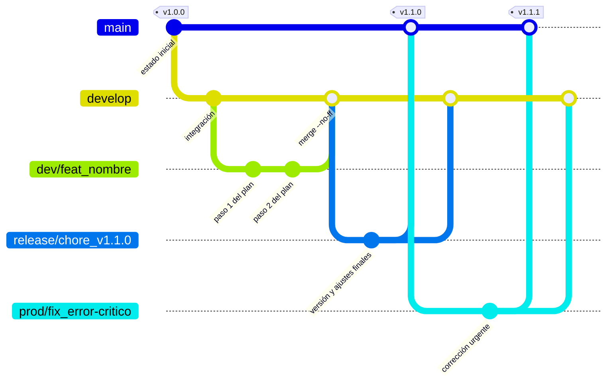

# Gitflow del proyecto

## Diagrama



(En un proyecto donde la rama de producción se llama `master`, léase `master` donde pone `main`.)

## Ramas

| Rama | Vida | Sale de | Vuelve a | Para qué |
| ---- | ---- | ------- | -------- | -------- |
| `main` (o `master`) | permanente | — | — | Código en producción. Cada merge en ella lleva una etiqueta de versión (`vX.Y.Z`). |
| `develop` | permanente | `main` | — | Integración. Contiene lo último terminado para la próxima versión. |
| `dev/<tipo>_<nombre>` | temporal | `develop` | `develop` | Trabajo normal: funcionalidades, refactors, bugs no urgentes, documentación, tests. |
| `release/<tipo>_<nombre>` | temporal | `develop` | `main` y `develop` | Preparación de una versión (por ejemplo `release/chore_v1.1.0`): solo ajustes finales y número de versión. |
| `prod/<tipo>_<nombre>` | temporal | `main` | `main` y `develop` | Hotfix: corrección urgente de un error en producción. |

## Nomenclatura de ramas de trabajo

```
<environment>/<tipo>_<nombre_funcionalidad>
```

- `<environment>`: el entorno sobre el que se trabaja: `dev` (sale de `develop`, lo habitual), `prod` (hotfix, sale de `main`) o `release`.
  - **No puede coincidir con el nombre de una rama permanente.** Git guarda las ramas como ficheros y carpetas: si existe `develop`, no puede existir `develop/feat_x` (ni `main` y `main/fix_x`). Por eso las ramas permanentes se llaman `develop` y `main` y los prefijos son `dev` y `prod`.
- `<tipo>`: el tipo de Conventional Commits que mejor describe el cambio: `feat`, `fix`, `refactor`, `docs`, `test`, `perf`, `build`, `ci`, `chore`.
- `<nombre_funcionalidad>`: el slug del plan sin fecha ni tipo, en minúsculas, sin tildes y con guiones (`asociar-vendehumo-usuario`).

Ejemplos: `dev/feat_asociar-vendehumo-usuario`, `dev/test_configurar-tests`, `prod/fix_token-expirado`.

El plan `docs/plans/2026-10-15-feature-asociar-vendehumo-usuario.md` da la rama `dev/feat_asociar-vendehumo-usuario` (el tipo `feature` del plan se traduce a `feat`, y `bug` a `fix`).

## Worktrees

Cada rama de trabajo se desarrolla en su propio `git worktree`, dentro de `.claude/workTrees/<rama con "/" sustituida por "-">` (carpeta ignorada por Git). Así el directorio principal no cambia de rama y varias ramas pueden avanzar a la vez.

- Un worktree por rama: Git no permite tener la misma rama en dos worktrees.
- Si la skill lanza tareas en paralelo, cada tarea de la tanda tiene una sub-rama y un worktree propios, con el sufijo `_t<N>`: `<rama-de-fase>_t<N>` (por ejemplo `dev/fix_vulnerabilidades-owasp_fase-3_t13`). Salen de la rama de fase y se integran en ella con `--no-ff` antes de continuar; los worktrees de tarea se retiran al integrarlas.
- Si el plan se implementa por fases, cada fase tiene su propia rama con el sufijo `_fase-<N>`: `dev/fix_<nombre>_fase-<N>` (y sus sub-ramas de tarea, `dev/fix_<nombre>_fase-<N>_t<M>`). Cada fase sale de `origin/develop`, se entrega con un pull request y no se empieza otra que dependa de ella hasta que ese PR esté mergeado.
- Comandos útiles: `git worktree add -b <rama> <ruta> origin/develop`, `git worktree list`, `git worktree remove <ruta>`, `gh pr create --base develop`, `gh pr list --state open`.

## Reglas

1. Nunca se commitea directamente en `main` ni en `develop`; solo se llega a ellas con merge (en `develop`, mediante un pull request).
2. **`main` y `develop` están protegidas para la skill `implement-plan`**: nunca las modifica. La skill termina publicando la rama `dev/...` con `git push -u origin <rama>` y abriendo un **pull request hacia `develop`** (`gh pr create --base develop`) (Fase 5 de la skill), tras actualizar la rama con `origin/develop` y comprobar que los tests pasan. **El PR lo revisa y lo mergea una persona**: la skill nunca ejecuta `gh pr merge` ni aprueba o cierra PR. Los `release` y `hotfix`, el merge en `main` y las etiquetas de versión también los hace una persona, fuera de la skill.
3. Los merges de PR en `develop` se hacen con merge commit (`gh pr merge --merge` o «Create a merge commit» en GitHub), no con squash ni rebase, para conservar la historia de la rama y de sus commits por tarea. Las ramas de fase salen de `origin/develop`.
4. Una rama temporal se borra después de integrarse, no antes.
5. Un `release` o `hotfix` se integra en `main` **y** en `develop`, y se etiqueta en `main`, también fuera de esta skill.
